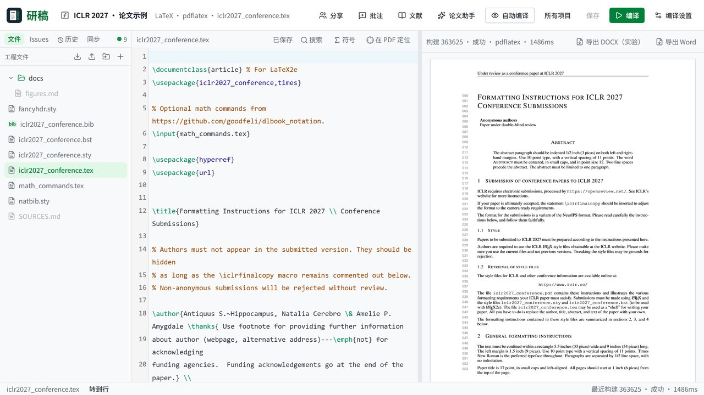
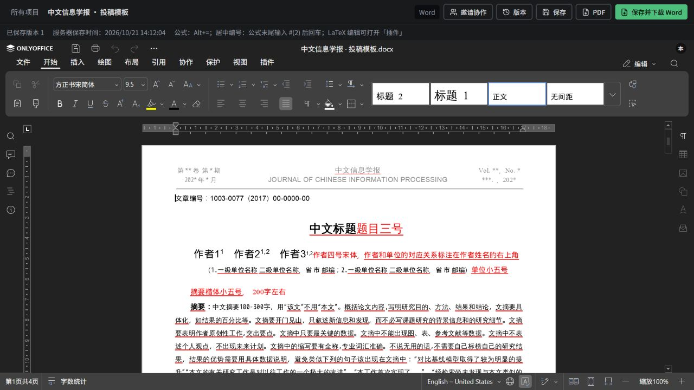

<div align="center">
  
  <h1>Paper Studio (研稿)</h1>
  <p><strong>Self-hosted collaborative academic writing platform for research teams — native Word &amp; LaTeX in one workspace.</strong></p>
  <p>
    <a href="README.zh-CN.md"><strong>中文文档</strong></a> ·
    <a href="#quick-start">Quick Start</a> ·
    <a href="#key-features">Features</a> ·
    <a href="#honest-boundaries">Honest Boundaries</a> ·
    <a href="https://github.com/nghqqa/paper-studio/issues">Issues</a>
  </p>
  <p>
    <a href="LICENSE"></a>
    <a href="backend/pyproject.toml"></a>
    <a href="frontend/package.json"></a>
    
  </p>
</div>

---

**Paper Studio (研稿)** is an open-source, self-hosted paper writing and review platform built for research labs and academic teams. Instead of splitting manuscripts across Overleaf, local Word files, chat threads, and scattered BibTeX libraries, Paper Studio brings **native LaTeX projects**, **native Word (`.docx`) journal templates**, **AI diff proposals**, **reference management**, **scientific figures**, **submission preflight checks**, and **multi-round rebuttal management** into one unified project.

<p align="center">
  
  
</p>

## Key Features

### Dual-Mode Authoring: Native LaTeX + Native Word
- **Native LaTeX Projects**: Multi-file `.tex`/`.bib`/`.cls`/`.sty` workspace with CodeMirror editor, auto-save & compile (`pdfLaTeX` / `XeLaTeX`), cancellable builds, real-time PDF preview, SyncTeX bidirectional navigation, `\cite`/`\ref` autocomplete, 124-symbol KaTeX palette, cross-file search (`Ctrl+Shift+F`), per-project Git history, and GitHub/Gitea push-pull sync.
- **Native Word (`.docx`) Projects**: Powered by self-hosted ONLYOFFICE Docs CE (`--profile word`). Keeps native pagination, tables, headers, columns, comments, and tracked changes. Ships with built-in plugins for:
  - **LaTeX Equation Plugin**: Insert & re-edit native OMML equations from LaTeX, plus `#(n)` centered-equation / right-aligned numbering via tab stops (no layout tables).
  - **Reference & Citation Plugin**: GB/T 7714-2015, IEEE, Springer LNCS, ACM, and Elsevier Vancouver styles; superscript citations and one-click bibliography rebuild / first-appearance renumbering.
  - **Scientific Figure Plugin**: Generate data charts (line, bar, scatter, pie) or draw method diagrams in **Excalidraw** (`.excalidraw` scene persisted + high-DPI PNG export) and insert/update directly in Word or publish into LaTeX `figures/`.

### Academic Workflow & Collaboration
- **Proposal-Confirmation AI Contract**: AI never silently overwrites manuscript source. Every reading, polishing, rewriting, or LaTeX compile-fix suggestion is generated as an auditable diff proposal that requires explicit human review (accept / edit & accept / reject / undo). Supports both organization-wide AI quotas and per-user BYOK API keys.
- **Zotero v2 & Literature Library**: Import via BibTeX, DOI, arXiv, OpenAlex, Crossref, or Zotero (public groups and private/personal libraries with encrypted/masked per-user API keys and incremental refresh).
- **Multi-Round Rebuttal & Response Letter**: Split reviewer comments into structured items, link to manuscript comment anchors, track multiple revision rounds, and export formatted Response Letters (`.md` / `.tex` / Word tab).
- **Submission Preflight Checks**: Read-only rule sets for Chinese journals (`jcip-preflight`, `cn-general`), double-blind anonymization (`double-blind`), and LaTeX structural checks.
- **Role-Based Access & Guest Review Links**: `owner` / `editor` / `reviewer` / `viewer` permissions enforced server-side, plus token-scoped passwordless public review pages for advisors (PDF preview, page-level annotations, final sign-off).
- **Admin Template Library**: Upload, edit metadata, atomically replace versions, auto-verify (real LaTeX compile / ONLYOFFICE conversion), and generate cover thumbnails for both Word and LaTeX templates.

## Quick Start

> **Requirements**: Linux/macOS/Windows with Docker and Docker Compose v2.

### 1. Quick Mode (LaTeX + AI + Zotero + Figures + Rebuttal)

Starts a single self-contained container in under a minute:

```bash
git clone https://github.com/nghqqa/paper-studio.git
cd paper-studio
cp .env.example .env
# Edit .env and set a random PAPER_STUDIO_SECRET (>= 32 chars):
#   openssl rand -hex 32
docker compose up -d
```

Open `http://localhost:8000` in your browser. The **first registered account** automatically becomes the platform administrator.

### 2. Full Mode (LaTeX + Native Word Editing via ONLYOFFICE)

```bash
# In .env, also set a random ONLYOFFICE_JWT_SECRET (>= 32 chars)
# and set PAPER_STUDIO_PUBLIC_ORIGIN / PAPER_STUDIO_ONLYOFFICE_URL to browser-reachable addresses.
docker compose --profile word up -d
```

For HTTPS reverse proxy configurations (Caddy & Nginx, including WebSocket and `X-Forwarded-Proto` headers required by ONLYOFFICE), see [`deploy/reverse-proxy/`](deploy/reverse-proxy/).

### 3. Build Locally (Optional)

```bash
# Mainland China mirror acceleration build args are supported:
# docker compose build --build-arg APT_MIRROR=mirrors.cloud.tencent.com \
#   --build-arg PYPI_MIRROR=https://mirrors.cloud.tencent.com/pypi/simple \
#   --build-arg NPM_MIRROR=https://registry.npmmirror.com
docker compose build
docker compose up -d
```

## Architecture

- **Backend**: FastAPI + SQLite (WAL) + `latexmk` (sandboxed with `-norc -no-shell-escape` and POSIX rlimits) + `pandoc` + `poppler-utils` + per-project Git history.
- **Frontend**: React 19 + Zustand + CodeMirror 6 + `pdf.js` + KaTeX + Excalidraw (lazy-loaded) + ONLYOFFICE Docs JS bridge.
- **Word Engine (Optional)**: Separate `onlyoffice/documentserver:10.0.0` container authenticated with short-lived JWTs.
- **Persistence**: Single Docker volume (`paper-data` mounted at `/data`) holds all projects, templates, SQLite database, and backups.

## Honest Boundaries

We prefer being transparent about current technical boundaries:

- **ONLYOFFICE Community Edition**: Runs as an independent container under AGPLv3 and enforces upstream's 20-concurrent-connection limit. For larger institutions, point `PAPER_STUDIO_ONLYOFFICE_URL` to a licensed Document Server.
- **Word Citations & Equation Numbering**: Because ONLYOFFICE CE does not expose native Word citation/SEQ fields, citations and equation numbers are platform-managed text/tab-stops with one-click renumbering and integrity verification.
- **Desktop Word / WPS Fidelity**: Paper Studio preserves font names in `.docx` without redistributing commercial fonts. Mount licensed fonts into `./fonts` on the server and verify final pagination in desktop Word/WPS before submission.
- **LaTeX Concurrency**: LaTeX source editing uses optimistic locking (`base_sha` conflict detection) rather than real-time CRDT co-editing.

## License & Acknowledgments

- **Paper Studio** source code is licensed under the **[Apache License 2.0](LICENSE)**.
- Built upon and evolved from the Apache-2.0 open-source foundation of `wookat/patent-studio` (see [NOTICE](NOTICE) for full copyright attribution and third-party notices).
- **ONLYOFFICE Docs CE** is deployed as an external independent container under **AGPLv3**; **CSL styles** are distributed under **CC BY-SA 3.0**; bundled LaTeX seeds retain their original `SOURCES.md` licenses (LPPL / official venue terms).
- **AI Safety Commitment**: Paper Studio is a writing and review assistant. It does not guarantee acceptance and never silently overwrites manuscript content without explicit human confirmation.
