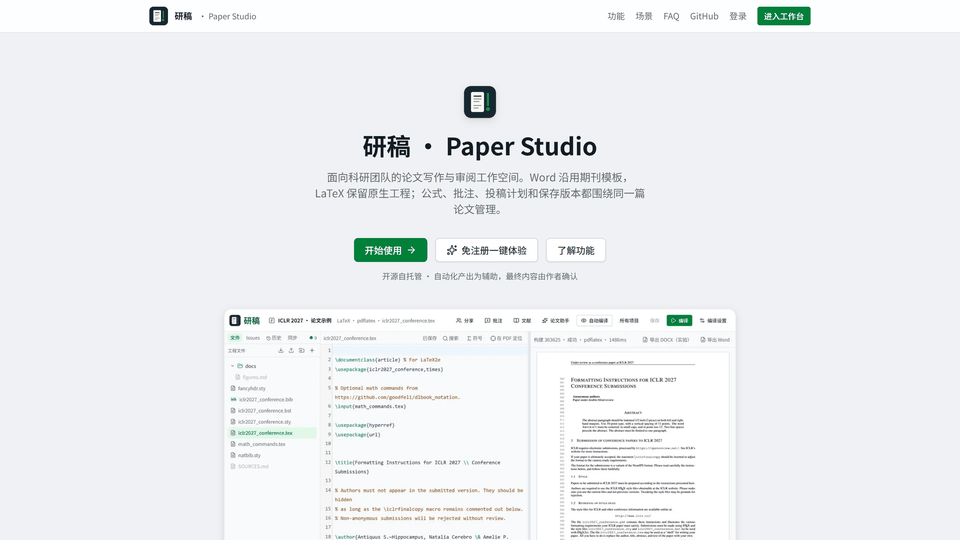
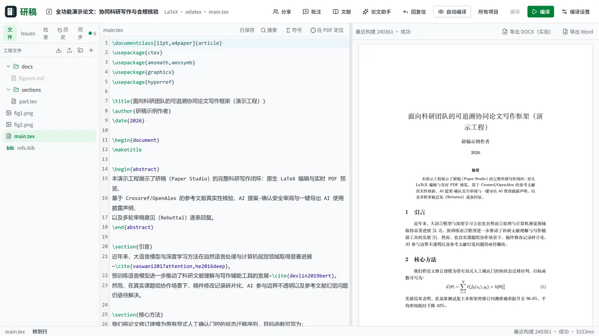
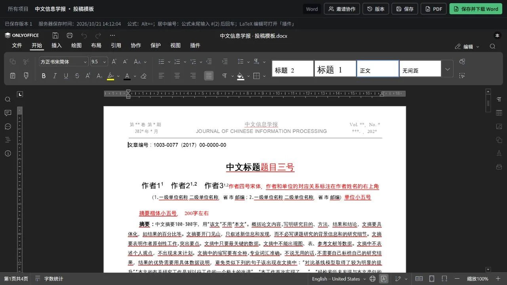
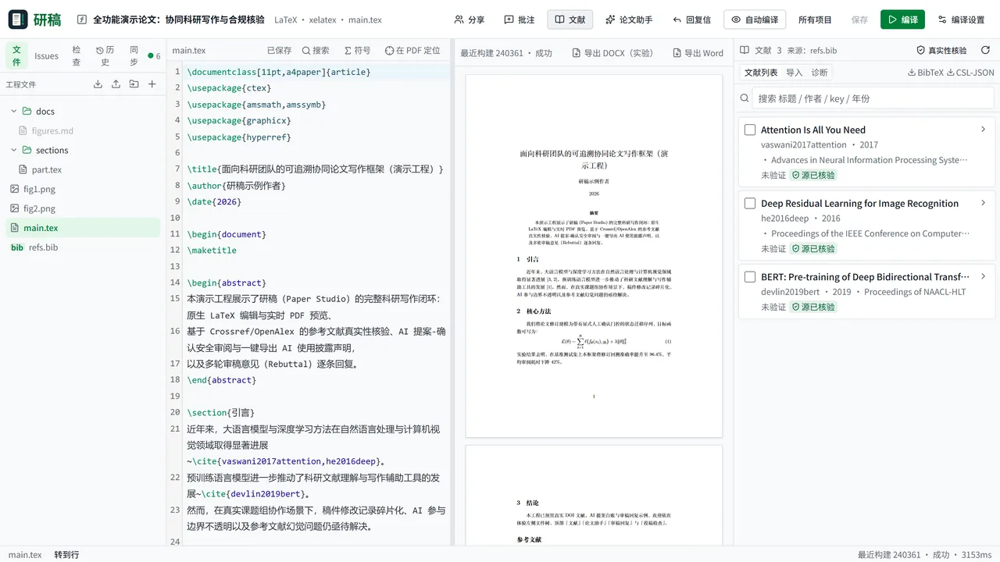
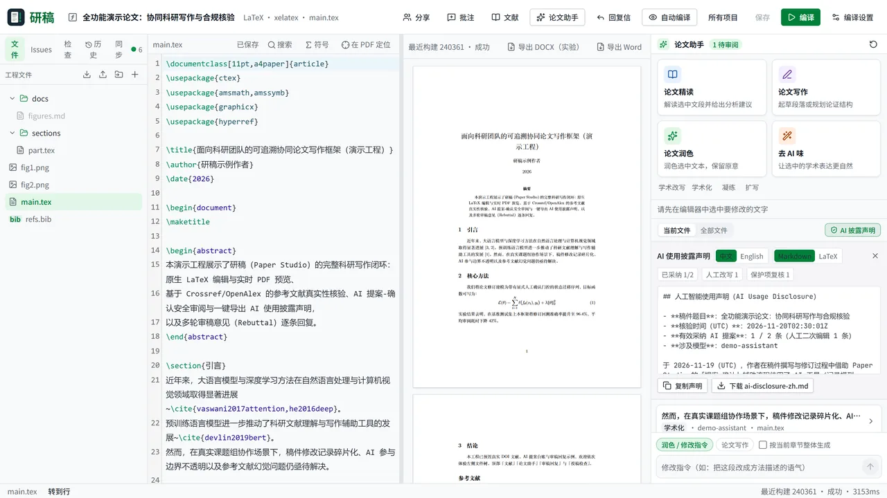

<div align="center">
  
  <h1>Paper Studio (研稿)</h1>
  <p><strong>Self-hosted collaborative academic writing platform for research teams — native Word &amp; LaTeX in one workspace.</strong></p>
  <p>
    <a href="README.zh-CN.md"><strong>中文文档</strong></a> ·
    <a href="https://paper.nghqqa.cn"><strong>Website</strong></a> ·
    <a href="#quick-start">Quick Start</a> ·
    <a href="#key-features">Features</a> ·
    <a href="#commercial-support--custom-deployment">Custom Support</a> ·
    <a href="https://github.com/nghqqa/paper-studio/issues">Issues</a>
  </p>
  <p>
    <a href="https://github.com/nghqqa/paper-studio/actions/workflows/ci.yml"></a>
    <a href="LICENSE"></a>
    <a href="backend/pyproject.toml"></a>
    <a href="frontend/package.json"></a>
    
  </p>
</div>

---

**Paper Studio (研稿)** is an open-source, self-hosted paper writing and review platform built for research labs and academic teams. Instead of splitting manuscripts across Overleaf, local Word files, chat threads, and scattered BibTeX libraries, Paper Studio brings **native LaTeX projects**, **native Word (`.docx`) journal templates**, **AI diff proposals**, **reference management**, **scientific figures**, **submission preflight checks**, and **multi-round rebuttal management** into one unified project.

<p align="center">
  
</p>

<p align="center">
  <em>Interactive live demo (no sign-up required): <a href="https://paper.nghqqa.cn"><strong>https://paper.nghqqa.cn</strong></a> → click <strong>免注册一键体验</strong></em>
</p>

<p align="center">
  
  
</p>

<p align="center">
  
  
</p>

## Key Features

### Dual-Mode Authoring: Native LaTeX + Native Word
- **Native LaTeX Projects**: Multi-file `.tex`/`.bib`/`.cls`/`.sty` workspace with CodeMirror editor, auto-save & compile (`pdfLaTeX` / `XeLaTeX` / `LuaLaTeX` + `biber`), cancellable builds, real-time PDF preview, cross-file `\input`/`\include` outline, SyncTeX bidirectional navigation, `\cite`/`\ref` autocomplete, 124-symbol KaTeX palette, cross-file search (`Ctrl+Shift+F`), per-project Git history, GitHub/Gitea push-pull sync, and LaTeX-to-Word export (`academic` / `thesis` / `jcip`).
- **Native Word (`.docx`) Projects**: Powered by self-hosted ONLYOFFICE Docs CE (`--profile word`). Keeps native pagination, tables, headers, columns, comments, and tracked changes. Ships with built-in plugins for:
  - **LaTeX Equation Plugin**: Insert & re-edit native OMML equations from LaTeX, plus `#(n)` centered-equation / right-aligned numbering via tab stops (no layout tables).
  - **Reference & Citation Plugin**: GB/T 7714-2015, IEEE, Springer LNCS, ACM, and Elsevier Vancouver styles; superscript citations and one-click bibliography rebuild / first-appearance renumbering.
  - **Scientific Figure Plugin**: Generate 10 publication chart types (`line`, `bar`, `scatter`, `pie`, `heatmap`, `boxplot`, `radar`, `violin`, `forest`, `grouped_bar`), reconstruct chart JSON from screenshots via **Vision OCR**, or draw method diagrams in **Excalidraw** (`.excalidraw` scene persisted + high-DPI PNG/PDF/SVG export) and insert/update directly in Word or publish into LaTeX `figures/`.

### Academic Workflow & Collaboration
- **Proposal-Confirmation AI Contract, Streaming & Native MCP Server**: AI never silently overwrites manuscript source. Every reading Q&A, academic translation (`zh↔en`), multi-turn refinement, polishing, rewriting, rebuttal draft, and LaTeX compile-fix suggestion supports SSE streaming and enters an auditable diff proposal queue. Supports **Citation-Aware AI** grounded in project references + PDF excerpts, Personal Access Tokens (PAT) with a native **MCP Server (`POST /api/mcp`)**, organization quotas, BYOK, and **bilingual AI Usage Disclosure** export.
- **Project Glossary, PDF Split Reader & Citation Fact-Checking**: Enforce terminology & math notation rules across LaTeX/Word (`Glossary & Notation`) with auto-extraction, editor autocomplete/hover definitions, and preflight checks; archive reference PDFs with a side-by-side text reader; reuse references & LaTeX snippets across projects; fact-check citations against Crossref/OpenAlex/arXiv and Zotero v2.
- **Multi-Round Rebuttal, Review Promotion & Deadline Calendar**: Promote advisor comments into LaTeX Issues or Rebuttal items, inspect sanitized public revision diffs, track submission deadlines on a monthly calendar with RFC 5545 `.ics` export, and see lightweight live collaborator presence avatars.
- **Submission Preflight Checks**: Read-only rule sets for Chinese journals (`jcip-preflight`, `cn-general`), double-blind anonymization (`double-blind`), terminology consistency, and submission readiness.
- **Role-Based Access, OIDC SSO & Portable Archives**: Server-enforced `owner / editor / reviewer / viewer` ACLs, optional **OIDC / OAuth 2.0 (PKCE) SSO**, **portable project archive `.zip` export/import**, and scoped token-based guest review links.
- **Admin Template Library, System Doctor, Hot Backups & Bilingual UI**: Upload and auto-verify templates with thumbnails; monitor storage & SQLite integrity via **Data Health & hot backup ZIP export** inside **System Doctor**; switch seamlessly between Simplified Chinese and English UI.
- **Instant Onboarding & Demo Mode**: One-click **Showcase Demo Paper** preloaded with LaTeX, real DOI citations, AI proposal audit records, and Rebuttal items; optional `PAPER_STUDIO_DEMO_MODE=on` for passwordless guest sandboxes.

## Quick Start

> **Requirements**: Linux/macOS/Windows with Docker and Docker Compose v2.

### 1. Quick Mode (LaTeX + AI + Zotero + Figures + Rebuttal)

Starts a single self-contained container in under a minute:

```bash
git clone https://github.com/nghqqa/paper-studio.git
cd paper-studio
cp .env.example .env
# Edit .env and set a random PAPER_STUDIO_SECRET (>= 32 chars):
#   openssl rand -hex 32
docker compose up -d
```

Open `http://localhost:8000` in your browser. The **first registered account** automatically becomes the platform administrator.

### 2. Full Mode (LaTeX + Native Word Editing via ONLYOFFICE)

```bash
# In .env, also set a random ONLYOFFICE_JWT_SECRET (>= 32 chars)
# and set PAPER_STUDIO_PUBLIC_ORIGIN / PAPER_STUDIO_ONLYOFFICE_URL to browser-reachable addresses.
docker compose --profile word up -d
```

For single-domain HTTPS deployments (exposing both Paper Studio at `/` and ONLYOFFICE at `/ds/` through one Caddy reverse proxy), use the included override:

```bash
docker compose -f docker-compose.yml -f docker-compose.proxy.yml --profile word up -d
```

Additional Caddy & Nginx templates are provided in [`deploy/reverse-proxy/`](deploy/reverse-proxy/).

> **Academic Fonts for Word Mode**: Commercial journal fonts (such as SimSun, SimHei, KaiTi, FangSong, Times New Roman, or Cambria Math) are intentionally excluded from the open-source image for licensing compliance. To match your journal's exact typography in ONLYOFFICE, place your licensed `.ttf`/`.ttc`/`.otf` font files into `./fonts` (or set `ONLYOFFICE_FONTS_DIR` in `.env`) and restart the `onlyoffice` container (`GENERATE_FONTS=true` rebuilds the font index automatically). Keep the folder lean (10–20 frequently used academic fonts) for fast editor startup.

### 3. Build Locally (Optional)

```bash
# Mainland China mirror acceleration build args are supported:
# docker compose build --build-arg APT_MIRROR=mirrors.cloud.tencent.com \
#   --build-arg PYPI_MIRROR=https://mirrors.cloud.tencent.com/pypi/simple \
#   --build-arg NPM_MIRROR=https://registry.npmmirror.com
docker compose build
docker compose up -d
```

## Architecture

- **Backend**: FastAPI + SQLite (WAL) + `latexmk` (sandboxed with `-norc -no-shell-escape` and POSIX rlimits) + `pandoc` + `poppler-utils` + per-project Git history.
- **Frontend**: React 19 + Zustand + CodeMirror 6 + `pdf.js` + KaTeX + Excalidraw (lazy-loaded) + ONLYOFFICE Docs JS bridge.
- **Word Engine (Optional)**: Separate `onlyoffice/documentserver:10.0.0` container authenticated with short-lived JWTs.
- **Persistence**: Single Docker volume (`paper-data` mounted at `/data`) holds all projects, templates, SQLite database, and backups.

## Honest Boundaries

We prefer being transparent about current technical boundaries:

- **ONLYOFFICE Community Edition**: Runs as an independent container under AGPLv3 and enforces upstream's 20-concurrent-connection limit. For larger institutions, point `PAPER_STUDIO_ONLYOFFICE_URL` to a licensed Document Server.
- **Word Citations & Equation Numbering**: Because ONLYOFFICE CE does not expose native Word citation/SEQ fields, citations use platform-managed blocks with one-click first-appearance renumbering and integrity verification, while equation numbers use tab-aligned plain text (with next-line wrap and legacy table migration, without automatic renumbering across equations).
- **Desktop Word / WPS Fidelity**: Paper Studio preserves font names in `.docx` without redistributing commercial fonts. Mount licensed fonts into `./fonts` on the server and verify final pagination in desktop Word/WPS before submission.
- **LaTeX Concurrency**: LaTeX source editing uses optimistic locking (`base_sha` conflict detection) rather than real-time CRDT co-editing.
- **UI Language**: The web interface is currently in Simplified Chinese (full English i18n is on the post-1.0 roadmap; bilingual AI Usage Disclosure export is already built in).

## Commercial Support & Custom Deployment

Paper Studio is free and open-source under **Apache-2.0**. For universities, research labs, hospitals, or institutes that need dedicated assistance, we also offer commercial support:

- **Private / Air-Gapped Deployment**: On-premise installation, HTTPS/reverse-proxy tuning, font setup, and backup drills.
- **Institutional Integration**: Campus SSO (CAS / LDAP / OIDC), custom AI gateway routing, and role/audit policy tailoring.
- **Custom Journal & Thesis Templates**: Verified Word (`.docx`) and LaTeX template packs + venue-specific preflight rulesets.

Visit our official site at **[paper.nghqqa.cn](https://paper.nghqqa.cn)** (contact details listed in the footer) or open a thread in **[GitHub Discussions](https://github.com/nghqqa/paper-studio/discussions)**.

## License & Acknowledgments

- **Paper Studio** source code is licensed under the **[Apache License 2.0](LICENSE)**.
- Built upon and evolved from the Apache-2.0 open-source foundation of `wookat/patent-studio` (see [NOTICE](NOTICE) for full copyright attribution and third-party notices).
- **ONLYOFFICE Docs CE** is deployed as an external independent container under **AGPLv3**; **CSL styles** are distributed under **CC BY-SA 3.0**; bundled LaTeX seeds retain their original `SOURCES.md` licenses (LPPL / official venue terms).
- **AI Safety Commitment**: Paper Studio is a writing and review assistant. It does not guarantee acceptance and never silently overwrites manuscript content without explicit human confirmation.
