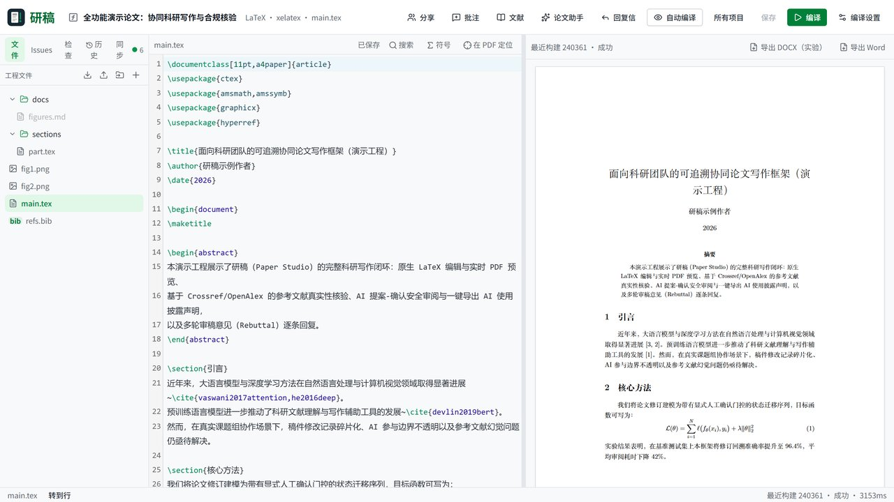
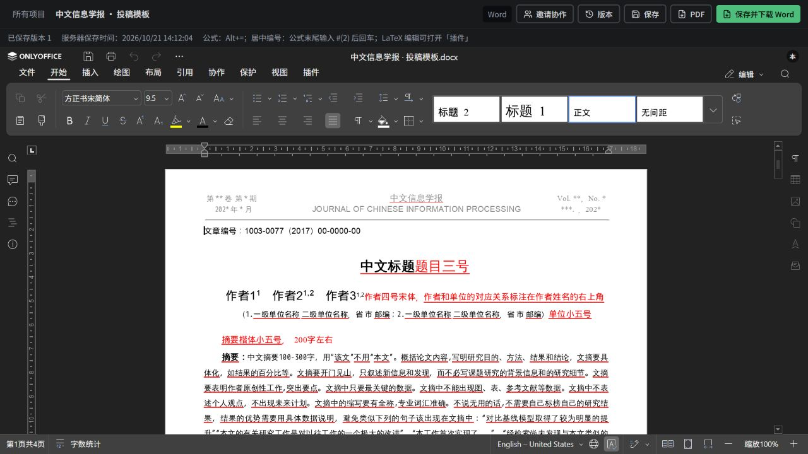

<div align="center">
  
  <h1>研稿 · Paper Studio</h1>
  <p><strong>面向科研团队的开源自托管论文协作平台——原生 Word 期刊模板与 LaTeX 工程收进同一个项目</strong></p>
  <p>
    <a href="README.md"><strong>English</strong></a> ·
    <a href="https://paper.nghqqa.cn"><strong>官网入口</strong></a> ·
    <a href="#快速开始">快速开始</a> ·
    <a href="#核心能力">核心能力</a> ·
    <a href="#私有化部署与定制服务">私有化定制</a> ·
    <a href="https://github.com/nghqqa/paper-studio/issues">问题反馈</a>
  </p>
  <p>
    <a href="https://github.com/nghqqa/paper-studio/actions/workflows/ci.yml"></a>
    <a href="LICENSE"></a>
    <a href="backend/pyproject.toml"></a>
    <a href="frontend/package.json"></a>
    
  </p>
</div>

---

**研稿（Paper Studio）** 是一款面向高校课题组与科研团队的开源、可私有部署论文写作与审阅平台。同一篇论文的 **Word 原稿或 LaTeX 源码、PDF 预览、数学公式、文献库、科研图表、AI 修改提案、审稿意见与多轮回复信** 全部收敛在同一个项目中，数据留存在部署方自有服务器。

<p align="center">
  
  
</p>

## 核心能力

### 1. 双模写作：原生 LaTeX + 原生 Word
- **LaTeX 工程工作台**：多文件 `.tex/.bib/.cls/.sty` 原样保留，CodeMirror 编辑 + 自动保存与编译（`pdfLaTeX` / `XeLaTeX`）+ 编译可中止 + 右侧实时 PDF 预览 + SyncTeX 双向定位 + `\cite`/`\ref` 补全 + 124 项 KaTeX 符号面板 + 跨文件搜索（`Ctrl+Shift+F`）+ 项目级 Git 历史快照 + GitHub/Gitea 推拉同步 + Word 双向导入导出。
- **Word 原生工作台（可选 `--profile word`）**：基于独立容器部署的 ONLYOFFICE Docs 社区版，保留原生分页、表格、页眉、分栏、评论与修订，并内置四大插件：
  - **LaTeX 公式插件**：通过 LaTeX 插入与再次编辑原生 OMML 公式；公式末尾输入 `#(n)` 回车生成居中公式+右对齐编号（纯制表位排版，不插表格），支持全文重编号与引用核对。
  - **文献与引文插件**：支持 GB/T 7714-2015、IEEE、Springer LNCS、ACM、Elsevier Vancouver 顺序编码样式，支持上标合并引用 `[1,2]`、按正文首现序一键重排与参考文献表重建。
  - **科研图表与方法图**：支持折线/柱状/散点/饼图数据图以及 **Excalidraw 方法图**（持久化 `.excalidraw` 场景真源 + 高清 PNG 导出），一键插入/原位更新 Word 正文或发布至 LaTeX `figures/`。

### 2. 学术写作与团队协作闭环
- **AI 提案-确认安全契约与一键 AI 披露声明**：AI 绝不静默改写作者正文。所有精读、润色、改写与 LaTeX 编译错误修复均生成可审阅的差异提案，经人工采纳/编辑后采纳/拒绝/撤销，全程可追溯；支持机构级每日配额、个人自带 API Key（BYOK，凭据不明文回传），以及**基于真实提案台账一键导出中英双语 AI 使用披露声明**（Markdown / LaTeX `\section*{AI Usage Disclosure}`，零编造、可直接附于期刊/顶会投稿）。
- **文献管理、Zotero v2 与参考文献真实性核验（防 AI 幻觉）**：支持 BibTeX / 7714 文本导入、DOI/arXiv/Crossref/OpenAlex 检索，以及 Zotero 公开群组与个人/私有库增量刷新；内置一键**「参考文献真实性核验」**，自动比对权威元数据标出「源已核验 / 字段偏差 / 未检出 / 权威源撤稿」，与「AI 披露声明」构成科研合规双保险。
- **多轮 Rebuttal 与回复信**：审稿意见自动/手动拆条、关联批注锚点、多轮归档（只读历史）并导出 `.md` / `.tex` 或 Word 回复信。
- **投稿前体检（Preflight）**：只读检查双语摘要与关键词、章节编号、模板占位残留、未处理修订/批注、引用完整性与双盲匿名化。
- **权限角色与免登录导师审阅页**：`owner / editor / reviewer / viewer` 服务端强制鉴权；支持签发有时效、可吊销的公开审阅链接，导师免登录即可查看 PDF、页级批注并确认定稿。
- **管理员模板库与系统诊断（System Doctor）**：内置 Apache-2.0 原创中文学术 Word 模板及 IEEE / ACL / ICLR / CVPR / NeurIPS / LNCS / Elsevier 等 LaTeX 种子模板；管理员可上传/替换模板并自动编译验收生成封面缩略图；内置**「系统诊断」**面板一键体检鉴权安全、磁盘、TeXLive/Pandoc、ONLYOFFICE 连通性与 AI 网关配置。
- **零门槛上手与免注册体验模式**：空首页一键加载「全功能演示论文」（预置 LaTeX + 真实 DOI 文献 + AI 提案台账 + 审稿回复）；支持可选开启 `PAPER_STUDIO_DEMO_MODE=on` 为官网提供免注册一键体验入口。

## 快速开始

> **环境要求**：Docker + Docker Compose v2。

### 方式一：轻量快速启动（纯 LaTeX + AI + 文献 + 图表 + Rebuttal）

默认仅启动单个应用容器，无需配置 ONLYOFFICE，1 分钟即可体验：

```bash
git clone https://github.com/nghqqa/paper-studio.git
cd paper-studio
cp .env.example .env
# 编辑 .env，设置至少 32 位随机密钥 PAPER_STUDIO_SECRET（可用 `openssl rand -hex 32` 生成）
docker compose up -d
```

浏览器打开 `http://localhost:8000`，**首个注册账号自动成为平台管理员**。

### 方式二：完整双模启动（LaTeX + 原生 Word 编辑）

```bash
# 在 .env 中补充随机 ONLYOFFICE_JWT_SECRET，并将 PAPER_STUDIO_PUBLIC_ORIGIN 与
# PAPER_STUDIO_ONLYOFFICE_URL 改为浏览器可访问的地址（局域网 IP 或 HTTPS 域名）
docker compose --profile word up -d
```

如需**单域名同源反代**（自动将 `/ds/` 转发至 ONLYOFFICE，无需额外暴露多端口），直接使用内置扩展编排即可：

```bash
docker compose -f docker-compose.yml -f docker-compose.proxy.yml --profile word up -d
```

更多 Caddy / Nginx 独立域名反代配置见 [`deploy/reverse-proxy/`](deploy/reverse-proxy/)。

### 方式三：本地从源码构建（支持国内镜像加速）

```bash
docker compose build \
  --build-arg APT_MIRROR=mirrors.cloud.tencent.com \
  --build-arg PYPI_MIRROR=https://mirrors.cloud.tencent.com/pypi/simple \
  --build-arg NPM_MIRROR=https://registry.npmmirror.com
docker compose up -d
```

> 兼容说明：环境变量优先读取 `PAPER_STUDIO_*`，同时完全向后兼容早期 `PATENT_STUDIO_*` 前缀。

## 架构概览

- **后端**：FastAPI + SQLite (WAL) + `latexmk`（`-norc -no-shell-escape` + POSIX rlimit 沙箱）+ `pandoc` + `poppler-utils` + 项目级 Git 历史。
- **前端**：React 19 + Zustand + CodeMirror 6 + `pdf.js` + KaTeX + Excalidraw（按需懒加载）+ ONLYOFFICE 插件桥。
- **Word 服务（可选）**：独立 `onlyoffice/documentserver:10.0.0` 容器，通过短期 JWT 与签名回调交互。
- **数据备份**：全部数据持久化在单一卷 `paper-data`（`/data`），停机打包卷即可完成一致性备份。

## 已知边界

我们坚持诚实披露当前工程边界：

- **ONLYOFFICE 社区版限制**：以独立容器运行（AGPLv3），受上游社区版 **20 并发连接**上限约束；大团队可将 `PAPER_STUDIO_ONLYOFFICE_URL` 指向自采商业版 Document Server。
- **Word 引用与公式编号**：受限于 ONLYOFFICE 社区版未开放原生 Word 引文域与 SEQ 域，目前采用平台托管文本/制表位机制，配合一键重排与完整性校验闭环。
- **桌面 Word / WPS 版式保真**：仓库不分发受版权限制的商业中文字体；可在服务器 `./fonts` 目录挂载已授权字体，并在正式投稿前使用桌面 Word / WPS 核对最终分页。
- **LaTeX 并发编辑**：采用基于 `base_sha` 的乐观并发冲突保护，暂不支持类似 Overleaf 的多人实时光标同编同一 `.tex` 文件。

## 私有化部署与定制服务

研稿（Paper Studio）核心代码基于 **Apache-2.0** 协议永久开源免费。若贵校课题组、学院、医院科研科或研究院需要省心的落地与定制支持，我们提供以下商业化服务：

- **实验室 / 院系私有化部署**：内网/离线环境交付、HTTPS 反代与 ONLYOFFICE 调优、期刊授权字体配置与灾备备份方案。
- **校内系统集成**：统一身份认证（CAS / LDAP / OIDC）对接、校内大模型网关接入、院系级配额与审计策略定制。
- **专属模板与投稿规则定制**：学位论文 / 目标中文核心与英文顶会 Word & LaTeX 模板适配、专属投稿前检查规则集开发。

有私有化部署或定制化需求，请访问官网 **[https://paper.nghqqa.cn](https://paper.nghqqa.cn)**（页面底部提供直接联系方式），或在 **[GitHub Discussions](https://github.com/nghqqa/paper-studio/discussions)** 留言沟通。

## 开源许可与致谢

- 本项目源代码采用 **[Apache-2.0](LICENSE)** 许可协议。
- 本项目源自并演进自 Apache-2.0 开源项目 `wookat/patent-studio`，完整版权声明与第三方组件许可见 [NOTICE](NOTICE)。
- 独立部署的 ONLYOFFICE Docs 社区版采用 **AGPLv3**；内置 CSL 样式遵循 **CC BY-SA 3.0**；各 LaTeX 会议/期刊种子模板许可逐项记录于对应目录 `SOURCES.md`。
- 本工具仅提供写作、编译与合规检查辅助，不承诺论文录用，请遵循目标期刊/会议的 AI 披露规范。
