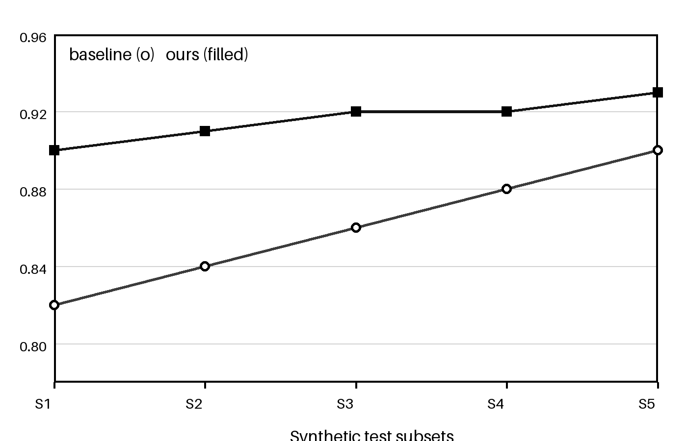

# 基于注意力机制的示例模型在中英混合文本分类上的应用

## 摘要

本文提出一种面向中英混合文本分类的示例方法 $A_{i}$，通过注意力机制融合双语特征。在合成数据集上的实验表明，所提方法的准确率较基线提升 3.2 个百分点。本文为合成示例论文，仅用于验证论文档案的解析、构建与导出管线，不构成真实研究成果。

关键词：示例；注意力机制；文本分类

## Abstract

This synthetic paper validates the paper-profile export pipeline. Inline math such as $x^{2}+y_{i}$ and displayed equations are written into DOCX as native OMML objects, so they stay editable in Word.

## 引言

文本分类是自然语言处理的基础任务，中英混合场景（code-switching）带来词表与语义对齐两方面的挑战。现有方法通常将两类文本分开建模，忽略了共享语义空间的作用。

本文的贡献如下：提出一种融合注意力权重的示例模型；在合成数据上验证其相对基线的提升；给出可复现的导出验证路径。

## 方法

### 模型结构

编码器输出 $h_{t}$ 与注意力权重 $\alpha_{t}$ 的计算方式如下：

$$\alpha_{t} = \frac{\exp(w^{T} h_{t})}{\sum_{k=1}^{T} \exp(w^{T} h_{k})}$$(1)

$$y = \sum_{t=1}^{T} \alpha_{t} h_{t}$$(2)

其中 $T$ 为序列长度，$w$ 为可学习的打分向量（synthetic scoring vector）。

### 训练设置

训练使用的主要超参数见表1。

表1 训练超参数（合成示例）

<!-- 表格: 三线 列宽=26,20,54 -->

| 参数 | 取值 | 说明 |
| --- | --- | --- |
| 学习率 | 3e-5 | AdamW 优化器 |
| 批大小 | 32 | 单卡训练 |
| 训练轮数 | 10 | 验证集早停 |

注：表中数值均为占位示例，不对应真实实验。

## 结果

{width=13}

如图1所示，所提方法在五个合成测试子集上的准确率均高于基线，平均值由 0.82 提升至 0.91。

## 讨论

本文方法的局限在于仅在合成数据上验证，真实中英混合语料上的表现有待检验。与文献[1]的观察一致，词表覆盖对混合文本分类影响显著；文献[2]的基线实现也用于本示例的对照。文内引用编号与「参考文献」节的双向对账检查属后续批次（w20 C2），本轮仅作普通文本渲染。

## 参考文献

[1] 张三, 李四. 中英混合文本分类综述. 计算机示例学报, 2025, 12(3): 45-52.
[2] Smith J, Doe A. A synthetic baseline for code-switch classification. Journal of Examples, 2024, 8(2): 101-110.
